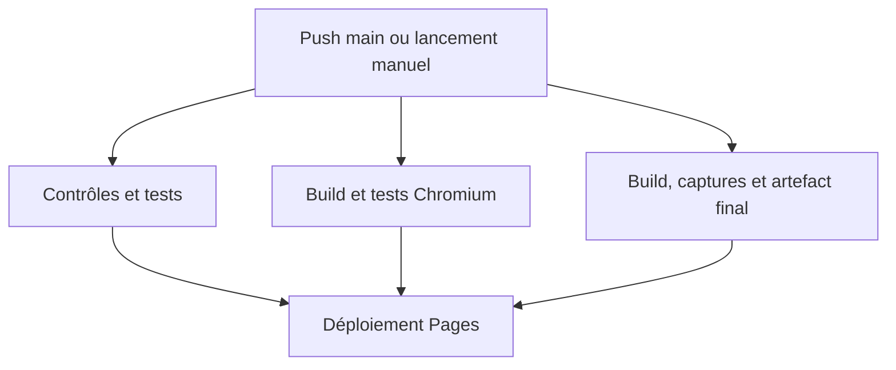

# Version 0.6.0 — installation, visite et sauvegardes

## Installer dans le dépôt

Extraire le contenu **à la racine**, en incluant le dossier `.github`. Cette livraison repart du ZIP 0.5.1. Si le dépôt a reçu d’autres modifications depuis, comparer les différences dans une branche avant de fusionner. Le fichier `src/cloud/config.js` reprend la configuration publique fournie avec la 0.5.1.

Le lien `./?installer=1` ouvre l’aide à l’installation. Le navigateur garde la main sur l’invite native. Le guide et le lexique sont accessibles dans Profil. Les exemples sont filtrés par usage et proviennent de [la liste modifiable](../src/data/exemples-visite.json). Voir [la notice](../src/data/README.md). Aucun exemple n’est importé dans l’espace personnel.

## Sauvegardes

La configuration Dropbox et le fonctionnement des 12 semaines glissantes sont décrits dans [la documentation cloud](CONFIGURATION_SUPABASE.md). Les copies de sécurité avant restauration et les archives héritées restent disponibles. Une restauration après conflit demande de comparer les données et de choisir quelle version privilégier pour les champs divergents. Une fusion conserve les enregistrements présents d’un seul côté ; elle peut donc réintroduire un élément précédemment supprimé.

## Déploiement GitHub Pages

Les vérifications Node lisent les sources et utilisent des données de test. La suite navigateur copie `_site` dans deux répertoires temporaires et y simule un changement de version. Les captures utilisent leur propre copie de `_site`, écrivent deux images dans `screenshots/` et modifient le manifeste source. La dernière construction recalcule la version et les empreintes du précache à partir de ces images et du manifeste, sans recompiler le bundle Supabase. L’artefact Pages n’est transféré qu’une fois. Les trois jobs peuvent démarrer ensemble sous réserve des runners disponibles. Aucun gain de temps chiffré n’est supposé.

## Réglages côté GitHub

Utiliser GitHub Actions comme source de Pages. Laisser Issues activé et vérifier que les labels `bug` et `enhancement` existent. Le ZIP n’applique aucun réglage de branche et ne change pas les permissions du dépôt.
